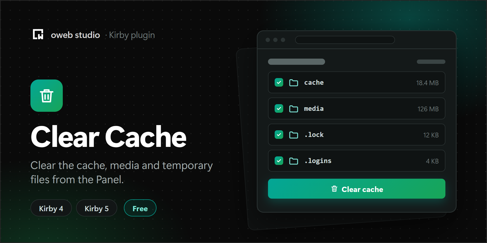

# Kirby Clear Cache

Clears the caches, media files and other temporary files of your Kirby site from the Panel or the command line.

## Requirements

- Kirby 6
- PHP 8.3 or newer

For Kirby 4 and 5, use [version 1.1.1](https://github.com/owebstudio/kirby-clear-cache/releases/tag/1.1.1) of this plugin.

## Installation

1. Download the latest release
2. Unzip downloaded file
3. Copy/paste unzipped folder in your `/site/plugins` folder

Or with Composer:

```
composer require owebstudio/kirby-clear-cache
```

## Usage

The plugin adds a **Clear cache** view to the Panel menu. It lists everything that can be cleared, with the number of files and their size:

- **Cache:** the caches of Kirby (pages, UUIDs, updates) and of your plugins. A cache is cleared for all domains of your site (for example with and without `www`) and for the command line. Caches in Redis, Memcached or APCu are cleared too.
- **Media:** copies of your files, thumbnails and the assets of the Panel and your plugins in the `media` folder. Kirby creates them again when they are requested. Clearing media files also clears the pages cache, so that cached pages don't link to missing thumbnails.
- **Other:** lock files from Kirby 3 and 4, and the failed login attempts.

Each entry can be cleared on its own, or all entries of a section at once. Clearing a whole section and resetting the failed login attempts ask for confirmation first.

The plugin only removes folders inside the cache and media folders. Folders that contain other parts of your site, for example when the media folder is configured as the index folder, are never listed or removed, and links are removed without touching their targets.

### Lock files from Kirby 3 and 4

Kirby 5 and newer keep content locks together with the unsaved changes. Kirby still reads the old `.lock` files from Kirby 3 and 4, and as long as such a file exists, it ignores the new lock of that page, file or user: two editors can then change the same page at the same time. The view shows these files only when there are some, in the `content` and `accounts` folders, and removes them.

### Failed login attempts

Kirby blocks users and IP addresses after too many failed logins and stores the attempts in `site/accounts/.logins`. Resetting them unblocks everybody right away.

## View button

The plugin also comes with a **Clear cache** button with a dropdown to clear the pages cache, all caches or all media files. Add it to the buttons of the site view in your `config.php`:

```php
<?php

return [
    'panel' => [
        'viewButtons' => [
            'site' => ['open', 'preview', 'languages', 'clear-cache']
        ]
    ]
];
```

Or to the buttons in a blueprint, for example `site/blueprints/site.yml`:

```yaml
buttons:
  - open
  - preview
  - clear-cache
```

The button only shows up for users who can clear the cache.

## Command line

With the [Kirby CLI](https://github.com/getkirby/cli), you can clear everything from the command line, for example in a deploy script:

```
kirby clear-cache               # lists everything with the number of files and the size
kirby clear-cache cache         # clears all caches
kirby clear-cache cache pages   # clears the pages cache
kirby clear-cache media         # clears all media files and the pages cache
kirby clear-cache other lock    # removes the lock files from Kirby 3 and 4
kirby clear-cache other logins  # resets the failed login attempts
```

## Permissions

Admins can always clear the cache. Other roles need the `owebstudio.clear-cache.clear` permission in their user blueprint:

```yaml
# site/blueprints/users/editor.yml
title: Editor
permissions:
  owebstudio.clear-cache:
    clear: true
```

To hide the plugin from a role, including admins, disable its area:

```yaml
permissions:
  access:
    clear-cache: false
```

## Translations

The Panel texts are available in English, German and Turkish.

## Upgrading from 1.x

- Version 2 needs Kirby 6 and PHP 8.3. Version 1.1.1 keeps working on Kirby 4 and 5.
- The cache section lists the caches by name instead of the folders in `site/cache`. Clearing all caches still empties the whole folder.
- The permission and the area name are the same as in 1.1.1.

## License

MIT
